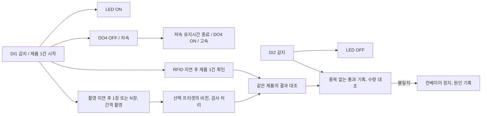

# 실무 공정, 계수, UX 요구사항

기준일: 2026-10-15. 사용자가 이 대화에서 확정한 내용이다. 실제 구현 완료를 뜻하지 않는다.
이 문서의 최신 요구는 기존 문서의 정지 검사, 수동 속도 조절 등 과거 설명보다 우선한다.
현재 코드 검토와 재현 결과는 [WORKFLOW_UX_REVIEW.md](WORKFLOW_UX_REVIEW.md)에 기록한다.

## 1. 확정된 요구

| 번호 | 확정 내용 |
|---|---|
| R01 | 공정 순서는 DI1 → 카메라, RFID 검사 위치 → DI2로 가정한다. 제품은 한 개씩 처리한다. 현장 배치가 다르면 사용자가 추후 정정한다. |
| R02 | 카메라 미리보기, 단일 촬영, 연속 촬영, OCR 시험, 센서 연동 촬영, 실제 검사 경로를 모두 조사한다. 사용자가 보고한 색상, 초점 차이는 수정 대상이다. 자동 화이트밸런스, 자동 초점이 원인이라고 아직 확정한 것은 아니다. |
| R03 | 카메라가 필요한 작업 중 연결이 끊기면 컨베이어를 정지한다. 설정한 간격으로 재연결을 시도하고 연결 복구 후 자동 재가동한다. 카메라를 사용하지 않는 센서 단순 계수는 카메라 단절로 정지하지 않아도 된다. 비전 와펜 계수는 카메라를 필요로 한다. |
| R04 | DO1은 기존 모터 운전, 정지 역할을 유지한다. DO4는 기존 DO1과 같은 GPIO 출력 방식으로 속도 선택 릴레이를 제어한다. 릴레이 3, 4번 NC 접점 개방(ON)은 고속, OFF는 저속이다. 고속, 저속의 실제 속도는 하드웨어에서 미리 정한다. |
| R05 | DI1의 0 신호 감지를 기준으로 저속 유지 종료, 촬영 시작, RFID 확인 시작을 각각 독립된 지연값으로 설정한다. 제품별 같은 기준 시각을 사용하며 앞 기능의 완료 뒤부터 다음 지연을 재는 직렬 방식으로 만들지 않는다. |
| R06 | DI1 감지 즉시 저속으로 전환하고, 설정한 시간이 지나면 고속으로 복귀한다. 단일 촬영과 다중 촬영을 설정에서 선택할 수 있어야 한다. 다중 촬영은 장수, 촬영 간격을 설정한다. 소요시간과 처리량의 차이를 확인할 수 있어야 한다. |
| R07 | LED는 DI1 감지 즉시 켜고 다음 센서인 DI2 감지 시 끈다. 이 공정 규칙에 임의의 지연, 유지시간, 촬영 완료 후 소등 옵션을 추가하지 않는다. |
| R08 | 수량 또는 검사 대조 결과가 다르면 반드시 정지한다. 경고만 하고 계속 운전하는 설정을 추가하지 않는다. DI2의 어느 신호 변화에서 1개를 확정할지는 아직 미정이다. |
| R09 | 와펜은 벨트 위의 단품을 센다. CVZone 방식과 YOLO 모델 방식 모두 중복 없이 추적하여 통과 수량을 센다. 사진 한 장의 검출 개수를 매 프레임 더하는 방식이 아니다. |
| R10 | 계수 방법은 관리자가 설정한다. 작업자는 CVZone/YOLO 알고리즘을 고르지 않고 관리자가 준비한 작업 옵션을 선택한다. 상세 알고리즘 설정을 작업자에게 노출하지 않는다. |
| R11 | YOLOv26 연동은 .pt와 .onnx 모델 파일을 지원한다. 아직 모델 파일은 없다. 모델 학습이나 모델 파일 제공을 이번 코드 검토의 선행 조건으로 요구하지 않는다. |
| R12 | 브랜드, 작업 선택에 따라 연결된 모델도 바뀌고, 어떤 모델이 선택, 적용되어 있는지 표시한다. 현재 탐지 대상은 와펜이며 다른 대상의 범위는 보류한다. |
| R13 | 브랜드, 기능별 프리셋을 상세히 저장한다. 구체적인 필드 묶음과 상속 규칙은 아래 설계 제안으로 구분한다. |
| R14 | 카메라와 다른 장비를 조정하고 시험할 때 비밀번호 입력과 설정/점검 화면 왕복을 줄인다. 현재 UX를 실제 조작 흐름으로 추적하여 개선한다. |
| R15 | 시작부터 종료까지를 한 작업으로 기록한다. 작업별, 일자별 통계와 CSV 내보내기를 지원한다. 총수량, 정상, 불량, 미판독, 재검사, 브랜드, 품번별 수량, 운전, 정지시간을 포함한다. |
| R16 | 문구는 짧고 구체적으로 작성한다. 엠 대시와 가운뎃점은 사용하지 않는다. 장식 요소를 줄이고 영상, 설정값, 실행 버튼을 쉽게 찾을 수 있게 배치한다. |

## 2. 정상 공정 기준

타이머 기준은 같은 DI1 이벤트다. DI2 통과, 영상 분석, RFID 응답은 완료 시각이 다르므로 서로 다른 제품 또는 아직 완료되지 않은 누적 수량을 단순 비교해서 오정지시키면 안 된다. 같은 제품/대상 구간을 연결한 대조 시점과 최대 대기시간은 설계에서 명시해야 한다.

### RFID의 “한 번 확인”

사용자는 제품당 한 번의 입력/확인으로 이해하고 있다. 현재 코드는 `station/rfid.py:133`에서 inventory를 시작하고 일정 시간 태그 응답을 수집한 후 EPC별로 중복을 묶는다. 같은 EPC의 반복 수신은 제품 수량이 아니다.

화면과 공정에는 제품별 확인 결과 한 건을 제공한다. 리더의 단발 명령을 사용할지, 내부 반복 응답을 묶을지, 무응답을 언제 실패로 확정할지는 실제 프로토콜과 대조해야 한다. 사용자가 불필요한 “읽기 시간창” 개념을 이해해야 기본 작업을 할 수 있도록 만들지 않는다. 이 세부 구현은 아직 사용자 확정 사항이 아니다.

## 3. 보류, 추가 설계 목록

| ID | 항목 | 현재 상태 / 처리 원칙 |
|---|---|---|
| P01 | 이전 제품 처리가 끝나기 전 다음 DI1 감지 | 사용자가 명시적으로 보류 요청. 대기열, 무시, 덮어쓰기, 정지 중 어느 것도 확정하지 않는다. 정상 검증은 한 제품씩으로 제한하고 이 경우는 별도 미해결 항목으로 남긴다. |
| P02 | DI2 계수 신호와 중복 억제 | 1→0 감지 또는 0→1 해제 중 확정 시점 미정. 센서 바운스, 장시간 가림, 정지 후 재통과, 역방향 통과의 처리도 함께 정해야 한다. |
| P03 | 와펜 이외 탐지 대상 | 사용자가 명시적으로 보류 요청. 모델별 클래스 확장은 가능하게 설계하되 실제 대상은 임의 확정하지 않는다. |
| P04 | 중간 제품이 있을 때 카메라 복구 | 자동 재연결, 재가동은 확정. 중단 제품의 미촬영, 미판독, 기존 타이머, 이미 처리한 계수 처리 방법은 미정. 재연결만으로 미확인 제품을 합격시키거나 중복 계수할 수 없다. |
| P05 | 수량 대조 완료 시점 | 불일치 시 정지는 확정. DI2와 비전 처리 시차, 무응답 제한시간, 같은 제품 연결 기준은 추가 설계가 필요하다. |
| P06 | CVZone 방식의 검출, 추적 세부 | CVZone 모드 지원은 확정. 윤곽/색상 등 검출 방법, ROI, 통과선, 방향, 크기 범위, 가림, 재등장 시 추적 정책은 아직 미정이다. |
| P07 | 실제 모델 계약 | .pt/.onnx 지원은 확정. 실제 파일의 입력 크기, 정규화, 출력 구조, 클래스 정보와 성능은 파일이 있을 때 검증한다. 현재는 런타임 인터페이스를 설계한다. |
| P08 | 지연, 간격, 재접속의 기본값과 현장 오차 | 설정 가능 요구는 확정. 실제 장비에서 사용할 수치와 허용 오차는 미정이다. ms 입력 가능하다는 사실을 1ms 정확도 보장으로 표현하지 않는다. |

DO4의 실제 GPIO offset 확인은 구현자가 하드웨어 명세와 대조할 작업이다. “DO4”를 임의 숫자의 GPIO offset으로 바꾸지 않는다. 이 확인을 이유로 이미 답한 고속/저속 동작을 사용자에게 다시 묻지 않는다.

## 4. 프리셋 구조 제안 : 아직 사용자 확정은 아님

장비 공통 설정과 브랜드, 작업별 공정 설정을 구분한다.

- 장비 공통: 카메라 식별자, DO1/DO2/DO4와 DI 배치, RFID 포트, 실제 장치 접근 설정.
- 브랜드, 작업 프리셋: 작업 옵션, 계수 방법, 모델 참조, 클래스, ROI, 통과선, 방향, 추적값, 카메라 촬영 프로필, DI1별 지연, 단일/다중 촬영, 장수, 간격, 대조 규칙, 재연결 간격, 기록 정책.
- 저장된 프리셋에는 버전을 부여한다. 작업 시작 시 브랜드, 옵션, 프리셋 버전, 모델 식별자를 작업 기록에 고정한다.
- 화면에서 편집 중인 값, 장비에 시험 적용한 값, 저장된 값, 실제 작업에 적용 중인 값을 구분한다.
- 모델 파일이 없거나 불일치하면 준비 상태에 구체적으로 표시한다. 다른 계수 방법으로 몰래 전환하지 않는다.
- 와펜 수량 단위는 “개”다. 기존 의류 화면의 “벌”을 그대로 쓰지 않는다.

## 5. 통계 범위 제안

작업별 원본 이벤트를 저장하고 그 자료로 일별 통계를 계산한다. DI2 통과 수, 추적 객체 통과 수, 검사 결과 수와 수동 보정 수는 별도 필드로 남기며 서로 합산해서 총수량을 부풀리지 않는다.

| 범주 | 기록할 항목 |
|---|---|
| 작업 식별 | 작업 ID, 시작/종료, 브랜드, 품번, 선택 옵션, 프리셋 버전, 계수 방법, 모델 이름, 해시/버전 |
| 수량 | 투입, 통과, 계수 확정, 정상, 불량, 미판독, 불일치, 재검사, 중복 억제, 수동 보정 전후와 사유 |
| 시간, 속도 | 운전, 정지, 대기시간, 정지 사유별 횟수/시간, 분당 처리량, 기능별 실제 지연, 촬영/추론 시간 |
| 장비 | 카메라 단절, 재연결 횟수/소요시간, RFID 오류, 모델 오류, 놓친 프레임, 처리 제한시간 초과 |
| 내보내기 | 작업별/일자별/브랜드별 필터, 한국어 UTF-8 BOM CSV, 수량 단위, 시각대, 집계 기준 명시 |

일자 기준은 기본 Asia/Seoul로 제안한다. 자정을 넘는 작업은 작업 전체 합계와 날짜별 발생분을 함께 조회하며, 운전시간과 정지시간도 날짜 경계에서 나눈다. 재검사, 수동 보정은 이력을 보존하고 원래 제품의 총수량을 중복 증가시키지 않는다. 사용하지 않은 검사 항목은 0건 실패와 혼동하지 않도록 미사용으로 표시한다.

## 6. 구현 상태

2026-10-16 기준 구현과 검증 결과는 [WORKFLOW_IMPLEMENTATION.md](WORKFLOW_IMPLEMENTATION.md)에 정리했다. 위 표의 미정 항목 중 P02는 설정 가능한 1→0 신호 유지 확인, P04는 같은 제품 ID 유지와 중단 시간 제외 후 미완료 검사 재개, P05는 제품별 DI2와 검사 완료 대조로 구현했다. P06은 밝기 윤곽과 방향성 중심 추적으로 구현했다. 이 선택은 소프트웨어 설계이며 현장 정확도 확인을 뜻하지 않는다. P01과 P03은 사용자 요청에 따라 보류 상태다. P07의 실제 와펜 모델과 P08의 실측값은 현장 확인 대상이다.
