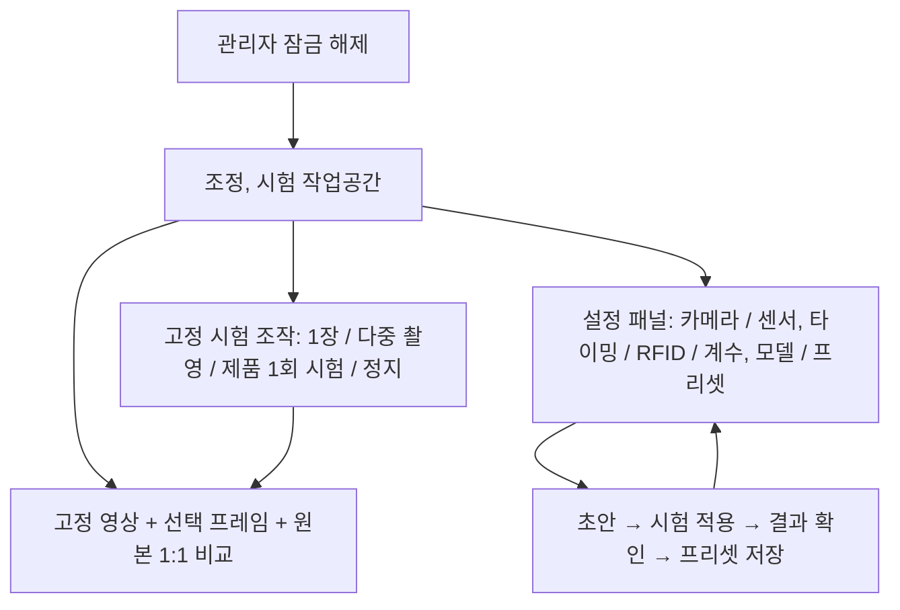

# 실무 공정 및 설정, 시험 UX 검토

검토일: 2026-10-15
검토 커밋: `6852b8632144e9d96175c9e40c728efad2231354`
요구사항 기준: [WORKFLOW_REQUIREMENTS.md](WORKFLOW_REQUIREMENTS.md)

## 검토 범위와 증거

현재 React 화면을 Chromium 1366×768에서 조작했다. 실제 FastAPI 서버, 인증, WebSocket, 별도 검토용 SQLite를 사용했다. 장비가 없는 클라우드이므로 카메라/GPIO 장비 응답만 브라우저에서 모의 처리했다. 따라서 화면 이동, 값 보존, 출력 정지 요청, 버튼 상태는 직접 확인한 결과이며 실제 카메라의 색상, 초점 변화나 모터 동작을 실측한 결과는 아니다.

기존 운영 데이터를 사용하지 않았다. 검토 도구와 증거는 저장소 밖 `/workspace/.txrx-review/`에 둔다.
- `ux-browser-review.json`: 조작 결과와 요청 기록
- `ux-review.cjs`: 브라우저 재현 스크립트
- `01-home.png`부터 `05-camera-settings-job-ready.png`: 재현 화면
- `camera-fixture.png`: 합성 테스트 영상이며 실제 촬영물이 아님

이 문서는 수정 전 검토 결과와 설계 기준이다. 이후 적용한 변경과 검증 결과는 [WORKFLOW_IMPLEMENTATION.md](WORKFLOW_IMPLEMENTATION.md)에 기록한다.

## 1. 직접 재현한 UX 문제

### U01. 화면 왕복으로 미저장 카메라 값이 사라짐 : 우선 수정

재현: 장비 연결 → 설정 읽기 → 초점 10을 42로 수정 → 장비 점검으로 → 카메라 설정 → 설정 읽기.

결과: 초점 값이 10으로 돌아왔다. 이동 전에 미저장 값에 대한 안내가 없었고, 돌아왔을 때 조절 항목을 다시 읽어야 했다. 설정값은 `DeviceSettings` 컴포넌트 내부 상태이며 화면이 해제되면 사라진다.

근거: [DeviceSettings.tsx](../ocr/frontend/src/components/DeviceSettings.tsx) 54~58, 76~96.
개선 기준: 조정, 시험 공간 안에서 초안과 선택 장치를 유지한다. 저장 전 이동을 매번 경고창으로 막는 방식보다 초안을 보존하고 적용/저장 상태를 표시하는 방식을 우선한다.

### U02. 조명을 켠 뒤 사진 확인 화면으로 가면 조명이 꺼짐 : 우선 수정

재현: 장비 연결에서 조명 시험 LED 켜기 → 장비 점검으로.
결과: 이동 시 `POST /api/bench/stop` 요청 1회가 발생하고 LED 시험 상태가 사라졌다.

근거: [DeviceTests.tsx](../ocr/frontend/src/components/DeviceTests.tsx) 29~68의 `useBench` 정리 동작. 출력 소유권이 화면 컴포넌트 수명에 연결되어 있다.
영향: 조명 조건을 만든 뒤 촬영 결과를 비교하는 과정에서 조건이 바뀐다. 단순히 정지 코드를 삭제하는 대신, 같은 조정, 시험 공간 내 이동에서는 소유권과 heartbeat를 유지하고 그 공간을 종료할 때 정리하도록 수명을 바꿔야 한다.

### U03. 센서 시험 설정도 화면 왕복으로 초기화됨

재현: 프레임 수 7, 상품코드 형식 `[A-Z]{4}` 입력 → 연결 설정 → 장비 점검으로.
결과: 프레임 수 3, 상품코드 형식 빈 문자열로 돌아왔다.

근거: [SensorPipelineTest.tsx](../ocr/frontend/src/components/SensorPipelineTest.tsx) 23~26.
영향: 조건을 조금씩 바꾸며 비교하는 반복 시험을 할 수 없다. 시험 초안, 직전 결과, 선택한 프레임, 확대 위치를 보존해야 한다.

### U04. 이동 중 시험 흐름이 서로 다른 버튼에서 다르게 막힘

재현: 장비 점검에서 모터 켜기.
결과: “사진 촬영”과 “현재 영상 OCR 검사”는 비활성화되지만 “센서 연동 OCR 시험 시작”은 활성 상태다.

근거: [DeviceTests.tsx](../ocr/frontend/src/components/DeviceTests.tsx)의 CameraTest, [Equipment.tsx](../ocr/frontend/src/screens/Equipment.tsx) 140~142, [bench_api.py](../station/bench_api.py) 59~66.
영향: 벨트를 움직이며 촬영 조건을 맞추려면 다른 실행 경로로 넘어가야 한다. 화면 버튼만 활성화해도 백엔드가 다시 거부한다. 장비 조정, 단일 제품 시험, 연속 공정 시험의 허용 동작을 같은 상태 모델로 정의해야 한다.

### U05. 작업을 만들기만 해도 카메라 조정이 잠김

별도 검토용 단순 작업을 생성한 직후 `READY` 상태에서 카메라 설정이 비활성화되는 것을 확인했다. 실제로 모터를 시작하기 전이다.

근거: [DeviceSettings.tsx](../ocr/frontend/src/components/DeviceSettings.tsx) 53, 97과 [station.ts](../ocr/frontend/src/lib/station.ts)의 `ended`; 서버 `editable`/장비 작업 제한도 함께 검토해야 한다.
개선 기준: 준비 중, 정지 상태에서 가능한 조정과 실제 운전 중 금지할 변경을 구분한다. 카메라 값 하나를 수정하려고 작업 전체를 종료, 재생성하게 만들지 않는다. 진행 중 제품이 있으면 그 제품의 적용 설정 버전을 유지해야 한다.

### U06. 조절값, 영상, 시험 버튼을 동시에 보기 어려움

1366×768에서 장비 점검의 스크롤 영역 높이는 628px, 내용은 3,522px로 약 5.6화면이었다. 카메라 설정도 노출/초점 값과 적용 버튼, 영상, 조명 스위치가 한 화면에 모두 들어오지 않는다. 화이트밸런스는 “추가 설정” 안에 숨겨져 있다.

개선 기준: 영상과 주요 시험 조작은 고정하고 세부 설정만 스크롤한다. 단일 촬영, 연속 촬영, 모델 검사 결과를 같은 비교 영역에서 확인한다. 숫자 조정 후 다른 영역으로 스크롤해야 효과를 볼 수 있는 구성을 줄인다.

### U07. 비밀번호 반복 입력 현상은 이번 체크아웃에서 미재현

설정 ↔ 점검을 여러 번 이동한 뒤에도 실제 서버의 인증 상태는 admin이었다. 현재 [Settings.tsx](../ocr/frontend/src/screens/Settings.tsx) 394~412는 기존 인증을 확인하며 “설정 잠금”을 눌렀을 때 명시적으로 잠근다. 서버 인증 유효시간은 12시간이며 서버 재시작 시 메모리 세션은 사라진다.

따라서 매번 비밀번호를 요구하는 현상을 확인했다고 보고하지 않는다. 현장 배포 버전, 명시적 잠금, 서버 재시작, 인증 만료는 원인 후보로 남긴다. 개선 UX는 현재 유지되는 관리자 인증을 보존하고, 조정, 시험 중 화면 이동을 없애 반복 로그인 가능성도 줄이는 방향이다.

## 2. 카메라 전 경로 대조

| 경로 | 현재 프레임 선택 / 표시 | 확인한 차이 |
|---|---|---|
| 설정, 일반 카메라 미리보기 | `/api/camera/frame`, 최신 프레임, 폭 1280 이하 JPEG, 요청 완료 뒤 500ms 후 재요청 | 화면은 원본과 1:1 비교가 아니며 표시 프레임 식별자가 없다. |
| 운전 화면 미리보기 | 같은 API, 750ms 주기 | 최신 장치 FPS와 표시 갱신 주기가 다르다. |
| OCR 시험 미리보기 | 같은 API, 요청 완료 뒤 700ms 후 재요청 | 화면에 보인 프레임과 검사 버튼이 읽는 프레임이 다를 수 있다. |
| 일반 사진 촬영 | `camera.after`, 호출 이후 두 프레임 이상 기다려 원본 PNG 저장 | 화면에 보이던 사진을 그대로 저장하는 기능이 아니다. 저 FPS에서는 지연이 커진다. |
| 연속 촬영 | 새 seq마다 원본 PNG 저장, 저장이 늦으면 프레임 건너뜀 | 지정 장수는 있으나 사용자 지정 촬영 간격은 없다. |
| OCR 시험 결과 | 검사 시 `read_latest` 1장을 고정, 표시 JPEG와 다운로드 PNG는 그 같은 프레임 | 결과 미리보기와 결과 원본은 같은 프레임이나 표현 크기, 압축은 다르다. |
| 센서 연동 OCR 시험 | 감지 이후 새 seq 수집, 최대 장수, 첫 문자 형식 일치 뒤 남은 OCR 생략 | 촬영 지연, 장간격이 없고 현재 미리보기와 결과를 동일 프레임으로 비교할 UI가 없다. |
| 실제 생산 검사 | 정지, 안정화 뒤 `camera.after`, 제품 검출 후 검사 | 이동 중 센서 시험과 다른 실행 흐름이다. |

근거: [app.py](../station/app.py) 553~570, [usb_camera.py](../station/usb_camera.py) 264~276, [bench_api.py](../station/bench_api.py) 284~338 및 369~393, [camera_batch.py](../station/camera_batch.py), [sensor_ocr.py](../station/sensor_ocr.py) 177~219, [runtime.py](../station/runtime.py) 179~216.

미리보기/저장 엔드포인트 자체에서 화이트밸런스나 초점 제어를 변경하는 호출은 확인되지 않았다. 카메라 프로필에는 자동 모드 제어가 허용되어 있고, 설정 적용 시 스트림을 닫았다 다시 연 뒤 한 번 재조회한다. 스트림 실행 중 설정이 변하지 않았는지 지속 확인하거나 각 촬영 프레임에 실제 제어값을 묶는 기능은 없다. Windows는 별도 DirectShow 제어 경로도 사용한다.

**확정한 것은 촬영 시점, 표현 방식의 차이와 설정 검증의 공백이다. 실제 장비에서 자동 WB/초점이 바뀌는 원인은 아직 미확인이다.** JPEG 차이만으로 사용자의 현상을 전부 설명하거나 수정 완료로 처리하면 안 된다.

수정, 검증 기준:
1. 실제 장치에서 자동 WB/초점/노출 상태와 수동값을 연결 전후, 설정 적용 후, 촬영 시 기록한다. 지원하지 않는 제어는 그렇게 표시한다.
2. 원본 프레임에 seq, 수신 시각, 설정 버전, 촬영 프로필을 연결하고, 검사, 결과 표시, 원본 저장이 같은 원본을 참조하도록 한다.
3. 실시간 미리보기와 “선택한 검사 프레임”을 분명히 구분한다. 같은 프레임의 1:1 확대 비교 기능을 둔다.
4. 드라이버 재연결 후에도 수동 설정을 다시 적용, 검증한다. 값을 적용하지 못했으면 성공 표시를 하지 않는다.
5. 현 USB 경로는 호스트 수신 시각만 제공한다. 센서 감지 후 ms 입력을 센서 노출 시작 시각과 동일하다고 주장하지 않는다. 실제 프레임 간격, 오차를 기록한다.
6. 다중 촬영 설정에는 장수, 간격, 총 수집 예상시간과 실제 수집시간/누락을 표시한다. OCR, 추적 결과 처리와 프레임 수집을 분리한다.

## 3. 실제 공정과 현재 코드가 맞지 않는 지점

| 우선 | 지점 | 현재 동작과 필요한 변경 |
|---|---|---|
| P0 | 정지 검사 엔진 | `Controller.begin`은 모터 정지와 STOPPING을 전제로 한다. `HardwareCycle.cycle`은 KM2 OFF → LED ON → 안정화 → 촬영 → RFID/비전 → 검사 완료 순서다. DI1 기준 독립 타이머 공정으로 재구성해야 한다. |
| P0 | 시험과 생산이 다른 엔진 | `SensorOcrTest`는 메모리 전용 시험이다. 센서 해제 시 수량을 올리고 미검출과 별개로 계속하며 생산 통계를 기록하지 않는다. 이것을 그대로 실제 계수로 사용하면 요구와 다르다. |
| P0 | 카메라 복구 | 현재는 active 상태에서 연결이 끊기면 FAULT로 전환한다. 주기적 카메라 재연결, 자동 재가동은 없고 기존 reset도 모터를 켜지 않는다. 카메라 복구 전용 상태를 구현해야 한다. |
| P0 | 단순 계수의 의존성 | `HardwareCycle.blockers`는 작업 종류와 관계없이 카메라, 검출기, RFID 읽기 시간을 요구한다. `tick`의 카메라/RFID 단절 처리도 단순 계수를 구분하지 않는다. 센서 단순 계수와 카메라 의존 비전 계수를 구분해야 한다. |
| P0 | 불일치 정지와 복구 원인 | 자동 재접속이 작업자의 정지나 수량 불일치 정지를 덮어쓰면 안 된다. “카메라 단절 때문에 운전이 중단된 작업”의 실행 의도를 유지하고 다른 정지 원인을 별도로 관리해야 한다. 정상 복구를 다시 수동 시작으로 바꾸는 것은 사용자 요구와 다르다. |
| P0 | LED 사건 연결 | 생산 LED는 정지 검사 단계, 시험 LED는 화면 소유권에 연결되어 있다. DI1 ON, DI2 OFF 사건으로 제어하도록 공정 상태와 출력 수명을 함께 정리해야 한다. |
| P1 | DO4 추가 | `StationConfig.do_lines`는 2개이며 GPIO/시험/대여 어댑터가 motor/led만 구분한다. 특히 BorrowedGPIO는 motor가 아니면 light로 보낸다. 속도 출력은 명시적 별도 채널로 끝까지 연결해야 한다. |
| P1 | 계수 확정 위치 | 현재 생산 수량은 검사 PASS 시 증가하고 DI2는 배출 완료를 감시한다. 이동 시험은 선택 센서 해제 때 증가한다. DI2, 비전, 검사 수를 별도로 수집한 뒤 동일 제품 기준으로 대조해야 한다. |
| P1 | 와펜, 모델 | Recipe는 simple/condition, 채널은 OCR/RFID/barcode뿐이다. CVZone/YOLO 탐지, 추적, 통과선, 모델 교체 경로가 없다. 기존 OCR 모델을 와펜 탐지 모델처럼 취급할 수 없다. |
| P1 | 관리자와 작업자 | 조건 계수 화면은 작업자에게 검사 채널을 선택하게 한다. 새 요구는 관리자가 방법, 모델을 프리셋에 고정하고 작업자는 옵션을 선택하는 구조다. 모델/방법은 읽기 전용 상태로 표시한다. |
| P1 | 프리셋 | 브랜드 revision과 작업 recipe snapshot은 있지만 전체 장비/타이밍/모델 프리셋은 없다. 여러 설정 저장 위치를 연결하고 작업별 적용 버전을 고정해야 한다. |
| P1 | 통계 | 작업, 검사, 수량, 이벤트 테이블은 있다. 일별 집계, 정지 구간별 시간, 모델별 비교, CSV API/UI는 없다. 기존 기록을 버리고 별도 카운터를 만드는 대신 이벤트와 제품 ID를 확장해야 한다. |

핵심 근거: [runtime.py](../station/runtime.py) 47~100, 125~146, 170~275; [controller.py](../station/controller.py) 123~136, 394~469, 530~541; [schema.py](../station/schema.py) 118~123, 210~225; [bench.py](../station/bench.py) 84~106, 129~147; [storage.py](../station/storage.py) 38~65.

## 4. 권장 UX 구조

### 작업자: 옵션 선택 → 작업 시작 → 결과 확인

작업자가 브랜드, 준비된 작업 옵션, 필요한 목표 수량을 선택한다. 계수 알고리즘, 모델 파일, 센서 지연, 카메라 제어는 관리자 프리셋을 사용한다. 선택한 옵션, 활성 프리셋 버전, 현재 모델, 계수 방법은 요약 상태로 보여 준다.

수량은 단순히 하나의 숫자만 보여 주지 않고 확정 수량과 확인 중 제품을 구분한다. 불일치가 나면 무엇을 비교했고 무엇이 달랐는지, 현재 제품이 무엇인지 보여 준다. 카메라 재연결 중에는 재시도 진행 상태와 복구 상태를 표시한다. 숫자가 다른데 표시만 정상으로 바뀌는 동작은 금지한다.

### 관리자: 하나의 조정, 시험 공간

- 한 번 잠금 해제한 관리자 세션을 유지한다. 명시적 잠금, 세션 만료는 화면에 상태로 표시한다.
- 카메라 장치와 지원 제어는 선택 후 자동 조회하며, 수동 재조회 버튼은 보조 기능으로 둔다.
- 영상, 원본 비교, 최근 시험 결과, LED 상태를 고정 영역에 두고 세부 제어만 스크롤한다.
- “현재 장치값 / 편집값 / 시험 적용값 / 저장값”을 구분해 저장하지 않은 변경을 잃지 않는다.
- 프리셋 초안과 시험 결과를 탭, 화면 왕복으로 초기화하지 않는다. 불필요한 확인창을 늘리는 대신 상태를 보존한다.
- 카메라 변경을 실제로 적용할 때 필요한 재연결, 잠시 대기는 명확히 보여 준다. 단순히 버튼을 풀어 실행 중 프로필을 중간에 바꾸지 않는다.
- 제품이 없는 READY나 조정 가능한 정지 상태에서는 전체 작업을 종료하지 않고 조정할 수 있게 한다. 생산 중 제품의 설정은 작업/제품 snapshot으로 고정한다.
- 수동 조명 시험과 자동 공정의 DI1/DI2 조명 제어 소유권을 명확히 표시한다. 화면 탭 이동이 공정 이벤트처럼 출력을 바꾸지 않도록 한다.
- 오류는 해당 조작 옆에 설명하고 “왜 비활성인지”와 바로 해결할 위치를 제공한다.
- 실제 장치 연결 단절, 창 종료와 같은 종료 감시는 유지하되, 같은 조정 공간 내 이동과 구분한다.
- 설정을 실제 운전에 반영하기 전에 동일 공정 엔진으로 “제품 1회 시험”을 실행하고 DI1, 속도, 촬영, RFID, DI2, 판정의 실제 시각을 한 타임라인에 보여 준다.

## 5. 공정 설계의 필수 경계

1. 제품마다 식별자와 DI1 기준 시각을 부여한다. 독립 타이머는 같은 시각에서 계산하고 카메라/추론이 느려도 센서, LED 처리까지 함께 막지 않는다.
2. 정지, 작업 변경 후 예전 지연 작업이 뒤늦게 실행되지 않도록 세대 번호와 취소 처리를 둔다.
3. 단순 계수, CVZone 와펜, YOLO 와펜, OCR/RFID 대조 작업 각각 필요한 장치만 시작 조건에 넣는다.
4. DI2 센서 입력 변화 횟수를 그대로 제품 수량으로 쓰지 않는다. 감지, 해제, 바운스, 동일 추적 객체의 재등장을 구분한다.
5. 비전과 DI2의 처리 시차를 불일치로 오판하지 않도록 제품 단위의 대조 시점과 제한시간을 정한다. 확정된 불일치는 즉시 정지한다.
6. 카메라 복구 시 새 프레임 수신과 저장된 촬영값 복원을 확인한 뒤 자동 재가동한다. 카메라 이외 정지 원인과 사용자의 명시적 정지 상태를 지우지 않는다.
7. CVZone과 YOLO는 서로 다른 검출기여도 추적 ID, 통과선, 계수 확정 계약을 공유한다. 같은 물체가 여러 프레임에 보여도 한 번만 센다.
8. .pt/.onnx는 파일 확장자만으로 호환성을 단정하지 않는다. 모델 정보와 출력 계약을 확인하고, 준비되지 않은 모델은 명시적으로 준비 실패로 표시한다.
9. 시험과 생산은 같은 공정 엔진, 프리셋을 쓰되 데이터의 목적을 구분한다. 시험 수량이 생산 통계에 섞이지 않게 한다.
10. 프리셋, 모델을 바꾸어도 과거 작업의 이름, 설정, 판정 근거가 바뀌지 않도록 적용 당시 값을 기록한다.

## 6. 수정 순서와 완료 기준

| 순서 | 수정 묶음 | 완료 판단 |
|---|---|---|
| 1 | 카메라 원본, 설정 일관성과 조정, 시험 공간 | 모든 영상 경로가 추적 가능하고 선택 프레임/다운로드 원본이 일치. 수동 설정 재연결 복원. 화면 왕복 없이 조명 조정, 촬영, 결과 비교. 초안, 시험값 유지. |
| 2 | 공정 엔진, DO4, 독립 타이머, 모드별 의존성 | 가짜 시간, I/O로 DI1→저속/LED→촬영/RFID→DI2 흐름 검증. 카메라 장애가 센서 단순 계수를 막지 않음. 카메라 의존 작업의 단절, 주기 재접속, 자동 재가동 검증. |
| 3 | 계수 일치성, 추적, CVZone/YOLO, 프리셋 | 동일 객체 다중 프레임, 센서 반복에도 중복 없음. 확정 불일치 정지. 관리자만 방법 설정. 브랜드/작업 변경 시 모델 준비, 표시, 설정 버전 일치. |
| 4 | 작업, 일별 통계, CSV | 작업 재검사, 수동 보정, 정지, 재연결, 날짜 경계가 원본 이벤트와 일치. 저장, 재시작 후 합계 보존. CSV와 화면의 필터, 합계 일치. |
| 5 | 현장 검증 | 실제 B0478 색상, 초점, 설정 복원, GPIO/릴레이 속도 전환, DI2 누락, 중복, 실제 모델 추적 정확도와 처리량을 같은 시나리오로 검증. 소프트웨어 모의 결과와 구분. |

P01(선행 제품 처리 중 다음 DI1), P02(DI2 확정 신호), P04(중단 제품 복구), P05(대조 시점)는 미정인 상태로 성공 처리하지 않는다. 결정 없이 임의 동작을 구현하거나 실무 프로세스가 완성됐다고 표시하지 않는다.

이번 검토에서는 애플리케이션, 테스트, 의존성 파일을 변경하지 않았다. 과거 온보딩의 자동 테스트 결과를 이번 하드웨어 검증 결과로 대체하지 않았다.
